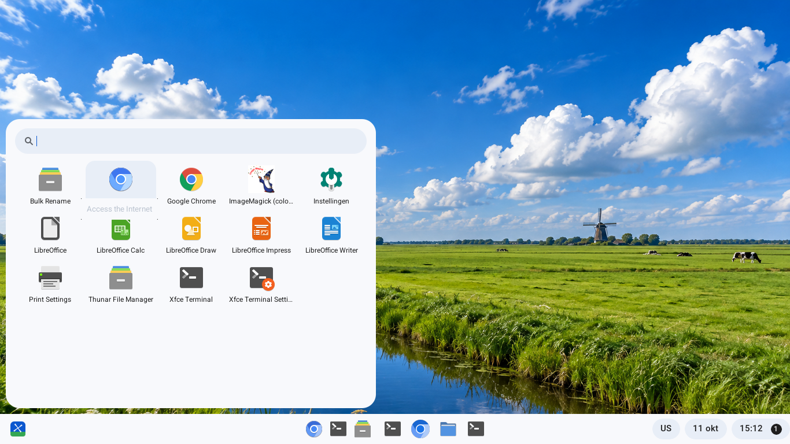
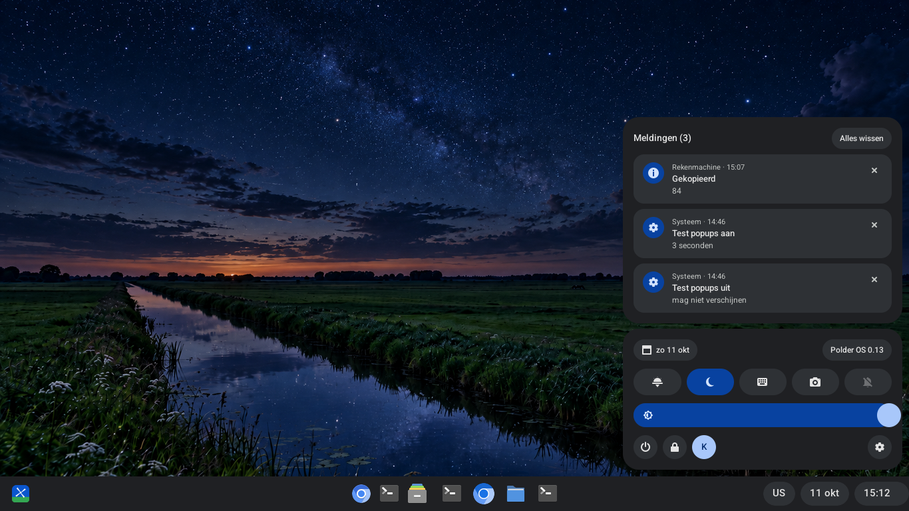
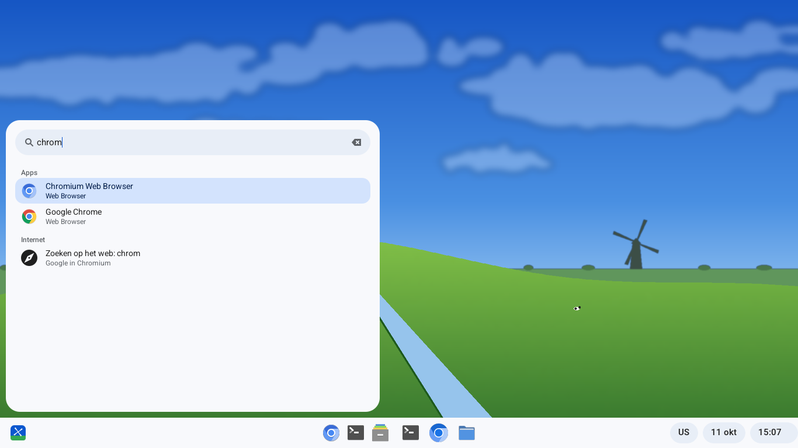
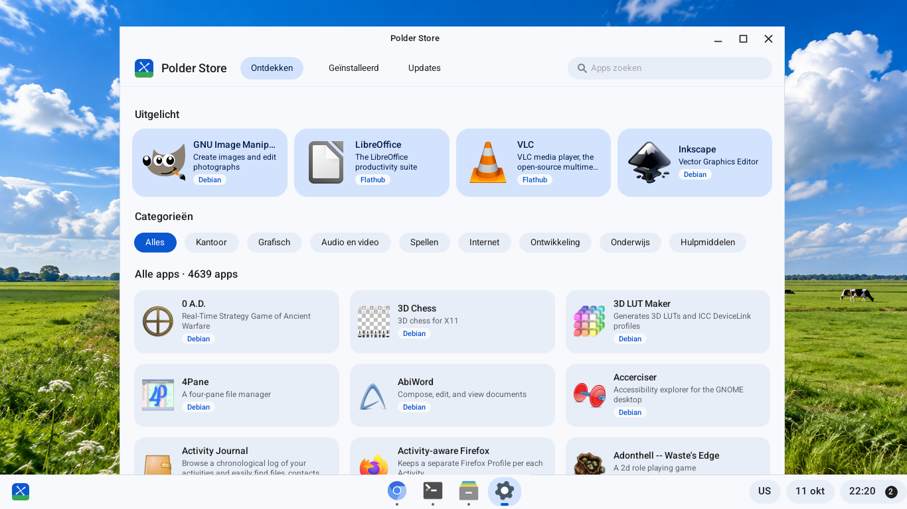
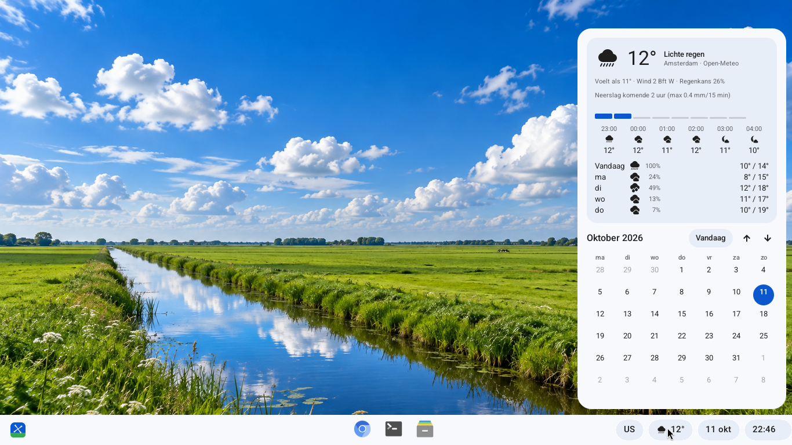
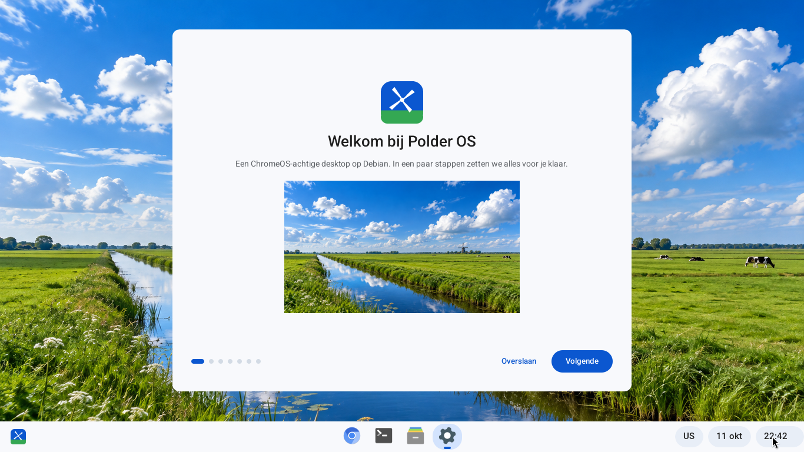

# Polder OS

**NL** – Polder OS is een ChromeOS-geïnspireerde Linux-distributie op basis van Debian 13 (trixie). Je krijgt een lichte, Nederlandstalige desktop met eigen plank, launcher, snelle instellingen, agenda, weer, vergrendelscherm, software-winkel en webapps, maar dan als volwaardige Linux met apt en Flatpak.

**EN** – Polder OS is a ChromeOS-inspired Linux distribution built on Debian 13 (trixie). It has a lightweight desktop (xfwm4 + picom + its own Python/GTK3 components) with a Dutch UI, light and dark themes, and real Linux underneath (apt + Flatpak).

| | |
|---|---|
|  |  |
|  |  |
|  |  |

## Features
- Shelf with pinned/running apps, right-click menus, status pills (keyboard, weather, date, time/notifications)
- Launcher with live search: apps, settings, files, calculator, web, "installeer <url> als app"
- Quick Settings (Wi-Fi, volume, dark theme, night light, Do not disturb, media card)
- Notification center (freedesktop daemon, actions, history, badge)
- Calendar popup with real iCal feeds (RRULE/timezones) and weather from Open-Meteo
- Instellingen (Settings) app: theme/accent/wallpaper, notifications, calendars, keyboard, weather, webapps
- Overview + Alt+Tab, window snapping and split view, virtual desks
- ChromeOS-style lock screen (PAM) and LightDM greeter
- Screen capture bar (screenshot/video), clipboard history (Super+V), keyboard shortcut viewer (Ctrl+Alt+/)
- Polder Store: software center for Debian (PackageKit) and Flathub (Flatpak) apps
- Webapps: install any site as its own app with its real icon
- "Welkom bij Polder OS" first-run tour; rounded windows via picom
- Bootable live ISO (Debian live-build) with Calamares installer

## Quick start: prototype session
Needs Debian trixie. The code expects to live at `/workspace/osbuilder` (the ISO build rewrites the paths):
```
git clone https://github.com/misterk99/polder-os /workspace/osbuilder
/workspace/osbuilder/config/start-session.sh     # installs deps, starts Xvfb :55 and the session
```
View `:55` with a VNC/X viewer, or grab it: `ffmpeg -f x11grab -i :55 -frames:v 1 shot.png`.

## Build the ISO
```
sudo apt install live-build qemu-system-x86
cd /workspace/osbuilder/iso
sudo ./build.sh          # → build/polderos-0.20-amd64.hybrid.iso (~1 GB)
./test-qemu.sh           # boot it in qemu
```
Live user: `polder` / `live` (autologin). See [CHANGELOG.md](CHANGELOG.md) for the full development log.
The commit history was reconstructed from the development log; intermediate file states were not preserved.

## License
GPL-3.0-or-later, see [LICENSE](LICENSE). The "Polderheuvel" wallpapers are the project's own AI-generated images. Debian packages keep their own licenses.
